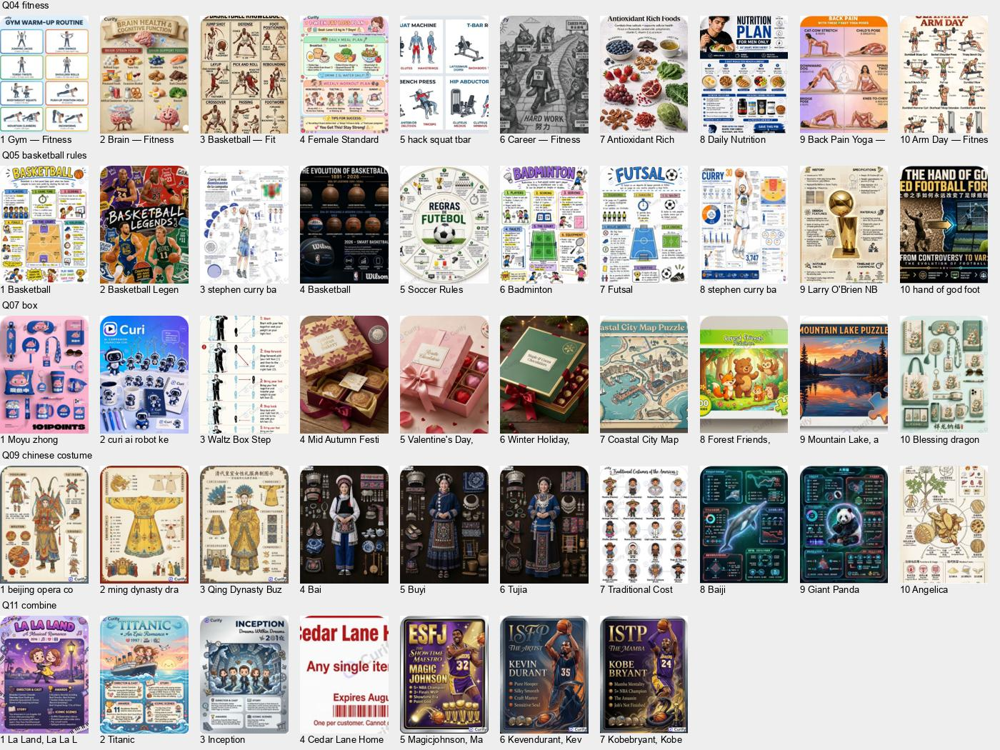
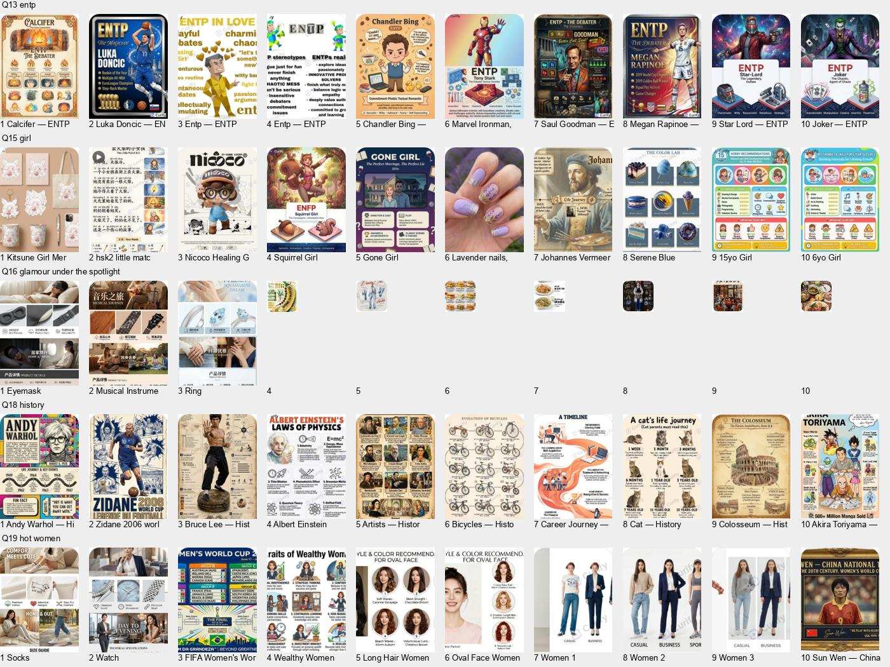
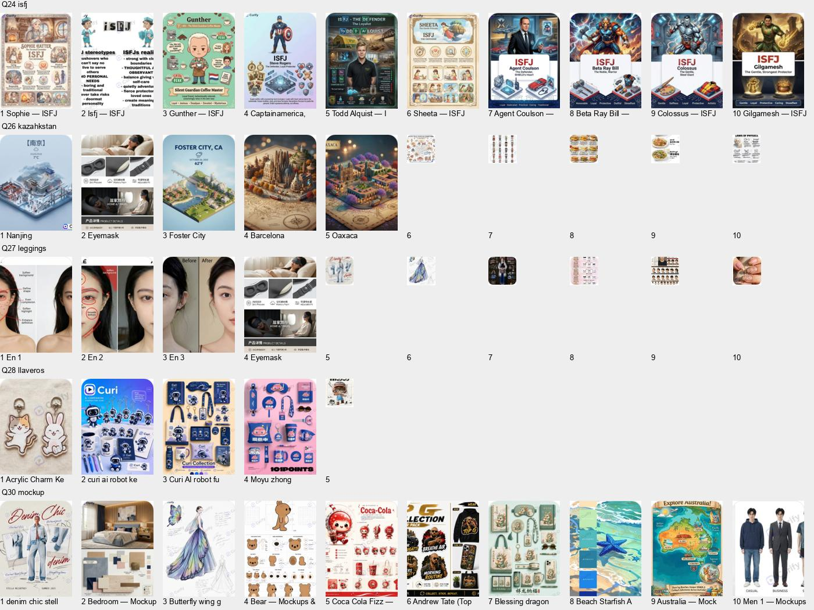
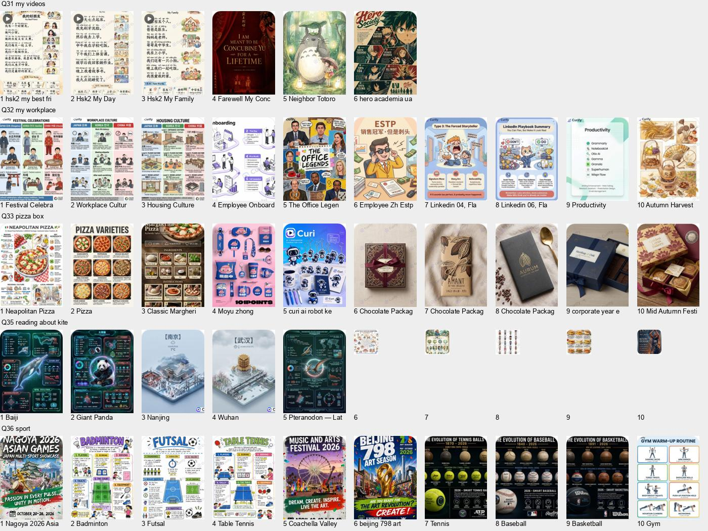
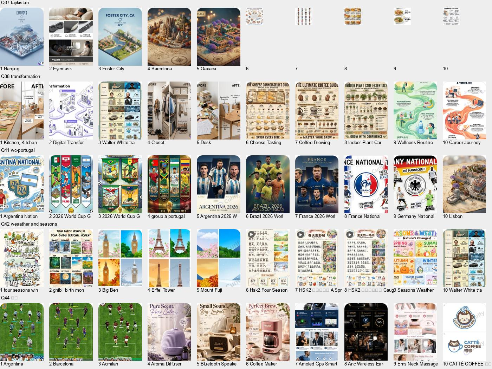

# 全量零点击查询质量审查 — 2026-11-07

时间窗：北京时间 10 月 31 日至 11 月 6 日。40 个公开查询全部检查，6 项隐私例外；前 10 个可见内容卡（不足 10 则全部），工具/空结果页核查实际目的地。默认英文站点重放，不等同于恢复每位访客的原语言或历史排名。

逐结果链接、人工相关性等级、分母和状态见 [query-audit.json](./query-audit.json)。grade=exact 为直接满足，useful-adjacent 为有用近邻，off-intent 为偏题，unclear 为意图不明；有用率不等于 CTR。

| ID | 查询 | 搜索 / 零结果 / 少结果事件 | 检查卡数 | 分类 / 优先级 | 处理 |
|---|---|---:|---:|---|---|
| Q01 | asl video translator | 5 / 0 / 0 | 0 | tool-navigation / P3 | 工具页正常；零卡点击不等于失败。 |
| P1 | [local-image-path-b1342bb9] | 2 / 1 / 0 | 0 | private-input / P2 | 已用虚构路径验证上传文件提示；不会读取、回显或重写用户路径。 |
| Q03 | flanderization | 1 / 2 / 0 | 0 | content-gap / P2 | 缺少人物性格扁平化的可视化解释；准备三阶段原创人物对照图，非已完成内容。 |
| Q04 | fitness | 2 / 0 / 0 | 10 | broad-topic / P3 | 健康与健身内容为主，Career 项偏题；不据宽泛查询认定缺内容。 |
| Q05 | basketball rules | 1 / 0 / 0 | 10 | retrieval / P1 | 已有篮球规则图；过滤其他运动及非规则内容。 |
| Q06 | bilingual subtitles | 1 / 0 / 0 | 0 | tool-navigation / P3 | 字幕工具页正常。 |
| Q07 | box | 1 / 0 / 0 | 10 | ambiguous / P2 | 包装、礼盒、舞步混合；box 未明确盒型，建议提供包装/其他含义选择。 |
| Q08 | ca | 1 / 0 / 0 | 0 | ambiguous / P3 | ca 意义不明，空结果不能证明内容缺口。 |
| Q09 | chinese costume | 1 / 0 / 0 | 10 | retrieval / P1 | 已有中国服饰；移除动物、草药及非中国服饰尾部。 |
| Q10 | chinese costume tryon | 1 / 0 / 0 | 0 | tool-navigation / P3 | 试穿入口已由上次修复恢复。 |
| Q11 | combine | 1 / 1 / 0 | 7 | task-navigation / P1 | combine 不足以确定对象；改为澄清提示及工作区入口。 |
| Q13 | entp | 1 / 0 / 0 | 10 | topic-navigation / P3 | ENTP 十项均与该主题匹配。 |
| Q14 | generar un video a partir de un link de diapositiva | 1 / 1 / 0 | 0 | capability-help / P1 | 幻灯片链接转视频能力未确认；说明限制并引导查看工作区，不生成无关图片。 |
| Q15 | girl | 1 / 0 / 0 | 10 | ambiguous / P3 | girl 覆盖人物、作品名、风格；不擅自推断年龄或具体任务。 |
| Q16 | glamour under the spotlight | 1 / 0 / 0 | 10 | retrieval / P1 | 画廊已有完全同名记录 750；补入精确检索索引，非内容缺口。 |
| Q17 | hacer un video | 1 / 0 / 1 | 0 | task-navigation / P1 | 西语“做视频”应选择视频流程，不应返回空图搜。 |
| Q18 | history | 1 / 0 / 0 | 10 | broad-topic / P3 | 历史人物与发展史为主，少量生命周期内容偏宽。 |
| Q19 | hot women | 1 / 0 / 0 | 10 | ambiguous / P2 | 前两项商品明显偏题，但用户期望风格不明确；暂不据此生成内容。 |
| Q21 | how long does it take to upload a video | 1 / 1 / 0 | 0 | help / P1 | 上传耗时问题应得到说明，而非图像生成器。 |
| P19 | [source-url-70ba13c1] | 1 / 0 / 0 | 0 | private-input / P2 | 私人来源网址不重放；已有视频网址选择器，具体来源是否受支持无法用脱敏记录断定。 |
| P20 | [source-url-7e6c6122] | 1 / 0 / 0 | 0 | private-input / P2 | 私人来源网址不重放；已有视频网址选择器，具体来源是否受支持无法用脱敏记录断定。 |
| Q24 | isfj | 1 / 0 / 0 | 10 | topic-navigation / P3 | ISFJ 十项均相关。 |
| P22 | [ASL-gloss-input-f5e496ee] | 1 / 1 / 0 | 0 | private-input / P2 | 粘贴手语 gloss 文本，不等同于 ASL 视频；文本转译能力尚未确认，不生成装饰图片冒充解决。 |
| Q26 | kazahkstan | 1 / 0 / 0 | 10 | retrieval+content-gap / P1 | 纠正国家拼写并过滤无关城市；现仅有 Kazakh 服饰近邻，仍缺国家介绍/地图。 |
| Q27 | leggings | 1 / 0 / 0 | 10 | retrieval / P1 | 画廊已有 leggings；恢复已目视确认的记录 4152，移除脸部修图结果。 |
| Q28 | llaveros | 1 / 1 / 0 | 5 | retrieval / P2 | 西语钥匙扣已有相关图；确定性同义词映射并过滤无关尾部。 |
| Q29 | manga translation | 1 / 0 / 0 | 0 | tool-navigation / P3 | 漫画翻译工具入口正常。 |
| Q30 | mockup | 1 / 0 / 0 | 10 | broad-topic / P3 | mockup 主题内容宽泛且大多相关，不证明缺口。 |
| Q31 | my videos | 1 / 0 / 0 | 6 | task-navigation / P1 | 个人视频应进入工作区，不是影视海报。 |
| Q32 | my workplace | 1 / 0 / 0 | 10 | task-navigation / P1 | 提供工作区提示，避免只返回职场海报；如果本意是职场内容可重新明确查询。 |
| Q33 | pizza box | 1 / 0 / 0 | 10 | content-gap+retrieval / P2 | 缺披萨盒设计；画廊提到 pizza boxes 的派对场景不满足包装需求。过滤食谱，准备包装概念 brief。 |
| P31 | [ASL-gloss-input-e8061854] | 1 / 1 / 0 | 0 | private-input / P2 | 粘贴手语 gloss 文本，不等同于 ASL 视频；文本转译能力尚未确认，不生成装饰图片冒充解决。 |
| Q35 | reading about kite | 1 / 0 / 0 | 10 | content-gap+retrieval / P1 | 缺风筝阅读图；已新增中英标签科普并过滤动物/城市结果。 |
| Q36 | sport | 1 / 0 / 0 | 10 | retrieval / P2 | 大部分体育结果相关，音乐节及艺术季混入。需另做广义体育主体约束，避免损伤多运动召回。 |
| Q37 | tajikistan | 1 / 0 / 0 | 10 | content-gap+retrieval / P2 | 没有 Tajikistan 国家内容；先去掉其他城市，再准备国家介绍/地图 brief。 |
| Q38 | transformation | 1 / 0 / 0 | 10 | ambiguous / P3 | transformation 可指家居、数字化、人物转变；前五项都有合理解释。 |
| Q39 | translate | 1 / 1 / 0 | 0 | task-navigation / P1 | 泛翻译请求应选择字幕/配音/漫画/手语工具。 |
| Q40 | video dubbing | 1 / 0 / 0 | 0 | tool-navigation / P3 | 视频配音入口正常。 |
| Q41 | wc-portugal | 1 / 0 / 0 | 10 | retrieval-navigation / P1 | 识别历史 wc-portugal 标识并转到葡萄牙世界杯主题。 |
| Q42 | weaather and seasons | 1 / 0 / 0 | 10 | retrieval / P1 | 已有 Seasons & Weather 内容；修正拼写并同时保留天气、季节主题。 |
| Q43 | 双语字幕 | 1 / 0 / 0 | 0 | tool-navigation / P3 | 双语字幕工具入口正常。 |
| Q44 | 徽章 | 1 / 0 / 0 | 10 | retrieval+content-gap / P2 | 球员阵容及电商卖点徽章不是徽章主体设计；过滤泛标签匹配，准备实体徽章/珐琅胸针 brief。 |
| Q45 | 风筝 | 1 / 0 / 0 | 5 | content-gap+retrieval / P1 | 与 reading about kite 同一缺口，共用新科普示例。 |
| P43 | [private-input-c5afd6ce] | 0 / 1 / 0 | 0 | private-input / P2 | 未重放原文；保留隐私例外。 |
| Q47 | ai fashion model generator | 1 / 0 / 0 | 0 | tool-navigation / P3 | AI 模特工具入口正常。 |
| Q48 | asl · american sign language | 1 / 0 / 0 | 0 | tool-navigation / P3 | 线上本次直接进入 ASL 工具页；不把它当成图片缺口。 |

## 图片审查证据

